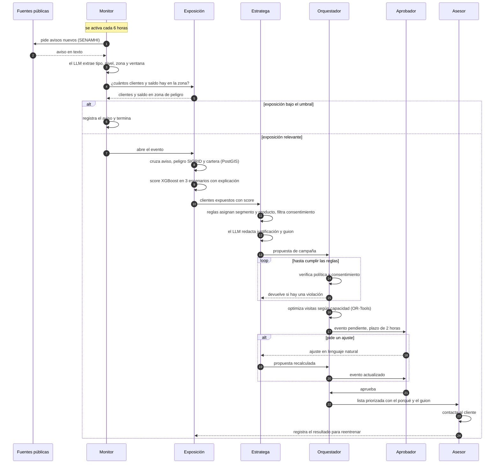
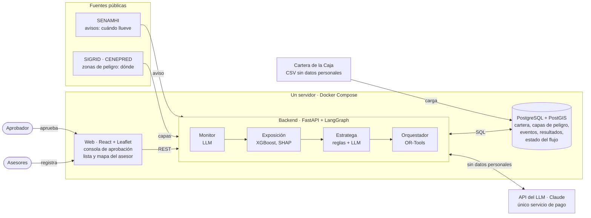

# Radar Climático — secuencia y arquitectura simple

Cómo viaja un aviso climático hasta la lista del asesor, y lo mínimo que hay que levantar para que funcione. Incluye los tres añadidos: Monitor que decide, ciclo de verificación y optimización de visitas.

Los diagramas están en Mermaid: se ven en GitHub y en VS Code (con la extensión Markdown Preview Mermaid Support).

## 1. Diagrama de secuencia

Nada llega al asesor antes del paso «aprueba».

Las tres decisiones que lo distinguen de una automatización fija:

- **El Monitor decide si abre un evento.** Un aviso que toca pocos clientes o poco saldo se registra y no molesta a nadie.
- **El Orquestador verifica antes de pedir aprobación.** Si la propuesta rompe una regla o ignora el consentimiento, vuelve al Estratega.
- **Una persona aprueba cada evento.** El comité aprueba las reglas una sola vez; el aprobador designado puede ajustar el evento escribiendo en lenguaje natural.

## 2. Arquitectura simple

Tres contenedores en una sola máquina. Lo único que sale del servidor son las llamadas al LLM, sin nombres, documentos, teléfonos ni coordenadas.

El backend corre una tarea programada cada 6 horas; el flujo se pausa hasta la aprobación y guarda su estado en la base. El mismo servidor puede ser una laptop en la demo o una máquina dentro de la nube privada de la Caja en un piloto, sin cambiar el código.

## 3. Cómo escala cada pieza

| Pieza simple                       | Cuándo se queda corta                      | Reemplazo                                      |
| ---------------------------------- | ------------------------------------------- | ---------------------------------------------- |
| PostgreSQL + PostGIS en contenedor | Muchas agencias consultando a la vez        | PostgreSQL administrado (Aurora)               |
| Tarea programada en el backend     | Muchas fuentes o avisos simultáneos        | Programador y colas (EventBridge, SQS)         |
| LangGraph en un proceso            | Flujos largos con auditoría formal         | Step Functions                                 |
| XGBoost dentro del backend         | Reentrenamiento periódico con datos reales | SageMaker                                      |
| Web React                          | Asesores sin señal en campo                | Aplicación con modo sin conexión             |
| Un servidor                        | Se exige alta disponibilidad                | Kubernetes en la nube privada de la Caja o AWS |
